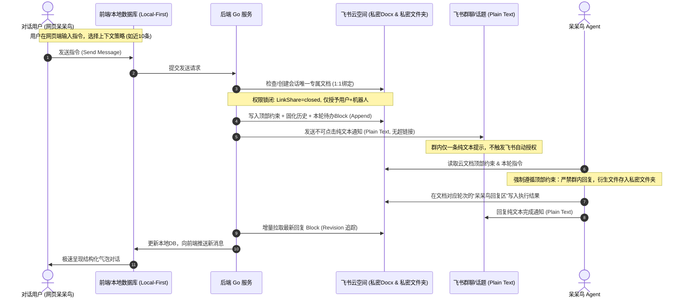

# 网页呆呆鸟（加密版）架构设计与会话文档模板规范

> **版本**：`v1.0.0-draft`  
> **分支**：`encrypted-edition`  
> **创建日期**：2026-11-05  
> **状态**：方案设计与评审

---

## 1. 设计背景与核心目标

### 1.1 核心痛点与威胁模型
在现有的飞书群聊与话题模式中，交互存在以下安全与权限风险：
1. **群内信息无差别暴露**：飞书话题中的普通消息在群内所有人可见，敏感业务分析、Prompt、执行细节无法实现点对点隔离。
2. **飞书富文本自动提权风险**：如果在群内发送普通云文档链接或文档卡片，飞书客户端与服务端会自动嗅探，并为当前群聊（`openchat`）或群成员下发阅读权限，导致机密扩散。
3. **衍生文件散落**：Agent 执行过程中生成的文件若直接发送到群内，将彻底丧失权限防护边界。

### 1.2 加密版核心目标
- **全密态会话载体**：整个话题（会话）的所有对话内容，**以 1:1 严格绑定的飞书私密云文档（Docx）**为唯一交互介质，每个会话对应且仅对应 1 个文档。
- **绝对零信任权限**：文档权限**仅对发起者（对话用户本人）与呆呆鸟应用机器人开放**，严禁对群组或任何第三方开放权限，且彻底关闭链接分享。
- **防自动提权 IM 通信**：群内通知采用**不可点击的纯文本（Plain Text）**方式发送，绝不触发飞书自动授权机制。
- **本地化优先与增量解析**：网页呆呆鸟端采用 Local-First 架构，聊天界面秒级呈现，对云文档采用增量 Block 变更追踪与历史轮次固化锁闭，兼顾极致安全性与高吞吐性能。

---

## 2. 总体架构与交互时序



---

## 3. 飞书权限隔离与防自动提权机制

### 3.1 严格权限白名单控制（Zero-Trust ACL）
每个会话文档在创建或首次交互时，后端强制通过飞书 Drive API 实施三层锁闭：
1. **公共链接分享关闭（LinkShare Closed）**：
   - 接口：`PATCH /drive/v2/permissions/{token}/public?type=docx`
   - 参数配置：
     ```json
     {
       "link_share_entity": "closed",
       "external_access_entity": "closed",
       "invite_external": false,
       "share_entity": "same_tenant",
       "manage_collaborator_entity": "collaborator_full_access"
     }
     ```
2. **协作者严格白名单（Collaborator Whitelist）**：
   - 仅包含两方：
     - **Owner**：用户本人 `openid:ou_xxx`（所有者/完整权限）；
     - **Collaborator**：呆呆鸟机器人 `app_id/bot_openid`（`edit` 编辑权限，以便回写内容）；
   - **强校验断言**：在每次交互前，调用 `verifyStrictPrivateDoc()`，一旦检测到任何 `openchat`（群组）、其他用户或非预期协作者，**立即熔断发送并自动清除越权成员**。

### 3.2 飞书群聊防自动授权规范（Plain Text Protocol）
飞书 IM 的防自动提权规范：
- **禁用消息类型**：严禁发送 `post` 富文本中的 `<a href="...">`、`<at user_id="...">` 以及飞书互动卡片中嵌入的文档链接；
- **强制使用 Plain Text 格式**：
  发往群聊的话题回复内容必须是原生 `text` 格式，且将文档 URL 用不可点击的形式封装：
  ```text
  【加密会话任务通知】
  本轮交互已封装至私密云文档中，请对话者通过专属文档查看与交互。
  文档地址（请复制后访问）：
  https://mytenant.feishu.cn/docx/doxcnxxxxxxxxxxxxxxxxxxxx
  （提示：群内成员未开放权限，访问将提示无权查看）
  ```

---

## 4. 会话文档模板规范（Docx Template Specification）

会话文档不仅是数据载体，更是对呆呆鸟（LLM Agent）的**强制 System Guardrails 物理承载物**。每个会话文档由以下四大核心区块构成：

```
+-----------------------------------------------------------------------+
|  🔒 网页呆呆鸟加密会话文档 (Docx Title)                                 |
+-----------------------------------------------------------------------+
|  [BLOCK 1: 顶级安全约束与执行准则] (Callout / 高亮警告卡片)               |
|  - 约束 1: 必须且只能在本文档的对应回复区输出结果                         |
|  - 约束 2: 严禁将任何业务内容、回答、分析发到群聊或话题中                  |
|  - 约束 3: 生成的物料必须上传到对应私密文件夹并在文档登记链接               |
|  - 约束 4: 群内回复仅允许纯文本文档地址，严禁富文本超链接                  |
+-----------------------------------------------------------------------+
|  [BLOCK 2: 会话元数据与审计信息] (Quote / 灰色引用区)                      |
|  - 会话 ID / 飞书话题 ID / 发起人 OpenID / 创建时间 / 文件夹位置           |
+-----------------------------------------------------------------------+
|  [BLOCK 3: 历史会话上下文] (Collapsible Toggle / 折叠只读区)              |
|  - 依据上下文策略滚动注入 (近10条 / 近20条 / 全部)                         |
|  - 每条历史消息标记 [只读固化·不可篡改]                                   |
+-----------------------------------------------------------------------+
|  [BLOCK 4: 当前交互轮次 (Turn N)] (Append-Only 活动交互区)                 |
|  ├─ 👤 用户本轮指令 (User Prompt Block)                                |
|  ├─ 🤖 呆呆鸟回复区 (Assistant Response Block - 占位后落盘)             |
|  └─ 📎 本轮衍生附件 (Deliverables / Artifacts List)                     |
+-----------------------------------------------------------------------+
```

### 4.1 详细模板结构（Markdown / Docx 映射定义）

````markdown
# 🔒 网页呆呆鸟加密会话 · [会话标题]

> ⚠️ **【呆呆鸟系统最高安全准则 (System Guardrails & Contract)】**
> 1. **仅在本文档输出**：呆呆鸟对本会话的所有回答、代码、分析、图表等成果，**必须且只能**写在本文档对应轮次的【🤖 呆呆鸟回复区】内。
> 2. **严禁群内明文泄密**：**严禁**将任何实际业务内容、方案细节或答案直接发送至飞书群聊/话题 IM 消息中。
> 3. **私密文件夹归档**：所有生成的衍生文件（PPT、PDF、代码、Excel、图片等），**必须上传至飞书对应会话私密文件夹**，并以文档链接的形式记录在底部的【📎 本轮衍生附件】中。
> 4. **防自动授权输出**：发回群聊的唯一内容只能是固定的纯文本通知字符串与本文档地址，禁止使用富文本超链接或飞书卡片。
> *注：本文档仅对发起人与呆呆鸟应用开放权限，任何越权协作者都将被自动化审计脚本移除。*

---

### 📋 会话信息与审计
- **会话标识 (Session ID)**: `om_19859d8aaecf1b58`
- **发起用户**: 李涛涛 (`ou_xxx`)
- **创建时间**: `2026-11-05 17:40:00`
- **专属私密文件夹**: [📁 会话私密资料库 (仅本人与机器人可见)](https://mytenant.feishu.cn/drive/folder/fldcnxxx)
- **上下文携带策略**: 携带近 10 条历史会话

---

### 📜 历史对话记录（已固化·只读不可篡改）

<details>
<summary>▶ 点击展开查看前序 10 条历史对话 (Turn 1 ~ Turn 10)</summary>

#### Turn 1 | 2026-11-04 10:00:00 [已归档]
- **用户**: 梳理 iBPC 实施项目双周计划
- **呆呆鸟**: 方案与进度已按要求输出，已沉淀入文档附件。

---
*(更多历史轮次依此类推)*
</details>

---

## 💬 当前交互轮次 · Turn 11

### 👤 用户指令 (User Input)
- **提交时间**: `2026-11-05 17:45:10`
- **指令内容**:
```text
请对 iBPC 项目管理计划中的 W02-W03 细项进行重新排期，并生成原生可编辑 PPT 方案放入私密文件夹。
```
- **附带参考资料**:
  1. `iBPC_ControlCall_20261105.html`（已上传至私密文件夹）

### 🤖 呆呆鸟回复区 (Assistant Output)
*(呆呆鸟执行任务中，内容将实时落盘于此处...)*

### 📎 本轮衍生附件 (Artifacts & Deliverables)
- 待呆呆鸟在任务完成后将生成的文件回填链接在此处。
````

---

## 5. 解析引擎与存储性能架构

针对用户特别指出的**“实时解析效率问题”**与**“如何解析、如何存储、如何固化”**，设计 **Local-First + 增量 Block 状态追踪（Incremental Block Tracking）** 架构。

```mermaid
graph TD
    UI[网页呆呆鸟 UI] -->|毫秒级读取| LocalDB[(本地数据库 / SQLite)]
    
    subgraph 写入流程
        Send[用户点击发送] --> SaveLocal[1. 写入本地 DB 待发送]
        SaveLocal --> RenderUI[2. 立即乐观渲染 UI (0延迟)]
        SaveLocal --> BuildDocx[3. 组装 Docx 增量 Block]
        BuildDocx --> AppendDocx[4. Append 追加至飞书云文档]
        AppendDocx --> SendIM[5. 发送 Plain Text 到群内触发任务]
    end

    subgraph 监听与拉取流程
        BotReply[呆呆鸟更新文档 Block] --> Poll[增量拉取器 / Webhook]
        Poll --> CheckRev{文档 Revision 是否变化?}
        CheckRev -- 未变 --> Skip[跳过]
        CheckRev -- 变化 --> FetchBlock[仅拉取最新 Turn Block]
        FetchBlock --> Parser[Block 反解析器 (Markdown/HTML)]
        Parser --> UpdateDB[更新本地 DB 对应消息状态]
        UpdateDB --> UpdateUI[增量刷新前端聊天气泡]
    end
```

### 5.1 数据存储模型（双层对齐设计）
1. **本地数据库模型（Local Source of Truth）**：
   - 沿用成熟的聊天结构模型，保证网页端无论历史有多长，打开话题即刻 0 毫秒渲染：
     ```sql
     CREATE TABLE encrypted_threads (
         thread_id TEXT PRIMARY KEY,
         doc_token TEXT NOT NULL,          -- 飞书 1:1 绑定的 docx token
         folder_token TEXT NOT NULL,       -- 会话专属私密文件夹 token
         title TEXT NOT NULL,
         owner_openid TEXT NOT NULL,
         context_limit INT DEFAULT 10,     -- 上下文携带策略 (10, 20, 30, 0表示全量, -1表示单轮)
         latest_revision INT DEFAULT 1,
         created_at TIMESTAMP,
         updated_at TIMESTAMP
     );

     CREATE TABLE encrypted_messages (
         id TEXT PRIMARY KEY,
         thread_id TEXT NOT NULL,
         turn_number INT NOT NULL,
         role TEXT NOT NULL,               -- 'user' | 'assistant' | 'system'
         block_id TEXT,                    -- 对应飞书 docx 中的 Block ID
         content TEXT,                     -- 解析后的 Markdown/纯文本
         attachments TEXT,                 -- JSON 数组
         is_frozen BOOLEAN DEFAULT FALSE,  -- 是否固化不可篡改
         status TEXT NOT NULL,             -- 'pending' | 'running' | 'done' | 'failed'
         created_at TIMESTAMP,
         updated_at TIMESTAMP
     );
     ```

2. **文档历史对话固化（Turn Immutability）**：
   - 每轮对话完成后（`status = 'done'`），本地记录 `is_frozen = true`，生成该轮次的数字签名 Hash（SHA-256）；
   - 后续任何交互追加，在飞书文档层面**只使用 `POST /blocks/:id/children` 追加新 Block**，严禁对已完成轮次的 Block 执行 `PATCH` 或 `DELETE`；
   - 本地解析器在遇到已冻结轮次时，直接走本地持久化缓存，绝对不向飞书发起二次网络查询。

### 5.2 效率与性能瓶颈破局点
- **拒绝全量拉取**：不再调用 `GET /open-apis/docx/v1/documents/:id/blocks` 全量拉取整篇文档。飞书文档在 300+ 轮次后可能有上千个 Block，全量拉取每次耗时 3~5 秒且容易超频被限流。
- **仅查增量 Block**：
  1. 通过获取文档元信息 `GET /open-apis/docx/v1/documents/:id`，对比 `revision_id` 是否递增；
  2. 若有更新，根据本地已记录的最新 `turn_number` 和 `block_id`，仅定位拉取最新活动的那个子 Block；
  3. 网络传输体积从几百 KB 骤降至 1~2 KB，解析耗时小于 10ms。

---

## 6. 前端 UI 与上下文策略控制设计

在网页呆呆鸟前端界面上，增加专门的【加密会话控制面板】：

### 6.1 上下文携带条数选择器（Context Window Controller）
在输入框工具栏上方，新增直观的上下文策略切换胶囊：
```
[ 🔒 加密文档模式 ]  上下文策略: [ 🔘 近10条 (推荐) ▼ ]
- 仅本轮 (极致隐私/单轮Prompt，无历史干扰)
- 近 10 条 (推荐，兼顾连贯上下文与Token效率)
- 近 20 条
- 近 30 条
- 全部历史 (长上下文)
```
- 切换策略时实时更新到 `encrypted_threads.context_limit`；
- 发送时，后端自动依据此配置，将前序对应数量的已固化历史装配进文档的历史折叠区中。

### 6.2 视觉与状态指示
- **会话标题盾牌**：会话列表与顶部显示金色安全盾牌 `🛡️ 密态文档会话`；
- **权限审计标签**：点击右上角盾牌可一键查看：“仅本人与呆呆鸟可见（LinkShare Closed · 0群组协作者）”；
- **历史固化徽标**：已完成的聊天气泡右上角显示灰色的“🔒 已固化”标记，表示该轮次已锁定且在飞书文档中只读。

---

## 7. 实施路线图与分支规划

当前开发分支已切为：`encrypted-edition`。建议分三阶段落地推进：

1. **Phase 1: 权限与飞书文档核心 SDK 封装**
   - 实现会话专属私密文件夹与私密 Docx 创建接口（`CreateEncryptedSessionDoc`）；
   - 实现权限自动锁闭与白名单校验逻辑（严格剔除 `openchat`）；
   - 实现 Plain Text 纯文本群聊触发机制。
2. **Phase 2: 模板组装器与增量 Block 解析器**
   - 编写 Docx Block 模板生成器（包含顶部 Callout 约束、历史折叠区、当前 Turn 结构）；
   - 实现增量 Block 监听与反解析（Docx Block -> 聊天富文本气泡）；
   - 本地持久化层设计与历史轮次固化锁。
3. **Phase 3: 前端交互改造与端到端自动化验收**
   - 前端新增加密模式切换、上下文选择器（近10/20/30/全部）；
   - 使用无头 Chrome 进行端到端加密链路自动化回归测试；
   - 多端交付包生成与交接文档归档。
